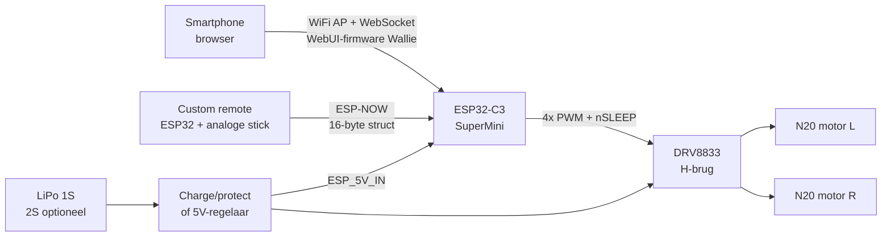
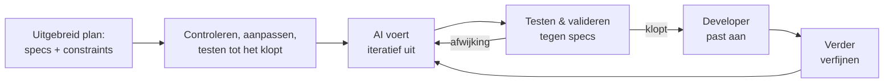

# Plan: Roboktober-presentatie, PHP Meetup Groningen

> Status: **concept** — eerst het plan afmaken, daarna pas de slides bouwen.

## 1. Basisgegevens

| Onderdeel | Waarde |
| --- | --- |
| Event | PHP Meetup Groningen |
| Datum | Donderdag 5 november 2026 |
| Spreker | Rein |
| Publiek | Breed technisch publiek: developers, engineers, makers (event is een PHP-meetup, maar analogieën zijn algemeen-technisch) |
| Taal | Nederlands |
| Duur | 60 minuten totaal (ca. 49 min talk + demo, 11 min Q&A) |
| Format | HTML-slides met **reveal.js** (lokaal gevendord, geen CDN, geen build-stap) + PDF-backup |
| Demo | Harmless robots (zonder actief wapen) mee, géén arena |
| Wallie | Niet aanwezig (geen tijd) — Rein presenteert alles, Wallie via foto's/video (§3.2) |
| Sidekick (onzeker) | **Hendrie** — lid Hackerspace Drenthe, maker, _"Mog groag mit dingn knooi'n"_. Mogelijke rol: vult aan en verbetert tijdens de talk, demo-assistent (robot besturen, remote/PCB rondgeven), helpt bij Q&A. Plan blijft solo uitvoerbaar; zie §7. |

## 2. Doel van de talk

- Het publiek enthousiast maken voor Roboktober en combat robots (antweight).
- **Kern:** technische deep-dive in de robot en de besturing ervan — elektronica, firmware en 3D-geprint chassis.
- Laten zien dat techneuten met hun bestaande kennis prima de stap naar hardware kunnen maken.
- Zijpaden (kort): de website (PHP-stuk) en het persoonlijke traject: in 3 maanden alles gebouwd met AI-assisted development.
- Uitnodiging: kom naar Hackerspace Drenthe / doe mee aan de volgende editie van Roboktober (in Coevorden) of Boeliebots (Groningen).

**Kernboodschap (concept):** _"Valideren, testen, reviewen: wat je als techneut al doet, werkt ook in een robot van 150 gram."_

### 2.1 Leerdoelen — wat neemt het publiek mee?

Na afloop kan iemand uit het publiek:
1. **Uitleggen hoe een commando van telefoon naar wiel gaat** (browser → WiFi → ESP32 → PWM → H-brug → motor) en waarom een failsafe daarin essentieel is.
2. **Herkennen dat dezelfde principes overal terugkomen** — in software, elektronica én 3D-ontwerp: invoer controleren, veilig stoppen bij storing, vaste afspraken (pin-mapping), automatisch testen (DRC/ERC, `assert`).
3. **Zelf beginnen:** weten dat een kit ~EUR 25 kost, firmware vanuit de browser flasht en een chassis als code te schrijven is.

### 2.2 Didactische principes

- **Van bekend naar nieuw:** elk technisch blok opent met iets uit het dagelijks leven of algemene techniek en bouwt daarop door.
- **Eén rode draad:** _"Wat gebeurt er als je op je telefoon de joystick naar voren duwt?"_ — dat ene commando volgen we door alle lagen heen.
- **Show, don't tell:** de robot rijdt al in de eerste minuut; demo's zitten verspreid op het moment dat ze iets uitleggen.
- **Afwisseling:** elke ~10 min een interactie of fysiek moment (rijden, iets laten rondgaan, handopsteken-vraag).
- **Eén idee per slide**, code max. ~10 regels, regels stapsgewijs highlighten (reveal.js `data-line-numbers`).
- **Elk blok eindigt met één takeaway-zin**; die komen samen terug in de afsluiting.

### 2.3 Brug-analogieën (bekend → robot)

Algemeen-technisch en uit het dagelijks leven, zodat ook niet-webdevelopers ze direct snappen.

| Robot-begrip | Herkenbaar als | Gebruikt in |
| --- | --- | --- |
| ESP32 met eigen WiFi-AP + WebUI | De WiFi-router thuis: eigen netwerk + instellingenpagina op `192.168.x.1` | §3.5.2 |
| WebSocket joystick ↔ ESP32 | Een open telefoonlijn in plaats van voor elk zinnetje opnieuw bellen | §3.5.2 |
| ESP-NOW-struct (8 × `uint16_t`) | Het datatype. Een vaste afspraak zodat beide kanten elkaar befrijpen | §3.5.2 |
| Web flasher (Web Serial) | Firmware-update zoals bij je printer of router, maar via de browser en een USB-kabel | §3.5.2 |
| Gas + sturen mixen | Sturen als een tank of graafmachine: verschil in snelheid links/rechts = draaien | §3.5.3 |
| PWM (duty cycle) | Een dimmer: de lamp heel snel aan/uit, "x% van de tijd aan" | §3.5.3 |
| H-brug | Zodat de motor beide kanten op kan met variabele snelheid | §3.5.3 |
| Failsafe bij verbindingsverlies (500 ms) | Dodemansknop in de trein / zekering in de meterkast | §3.5.3 |
| Pin-mapping (GPIO → functie) | afspraak welke draad waar zit | §3.5.4 |
| DRC/ERC in KiCad | Unit-test voor elektronica | §3.5.4 |
| OpenSCAD `assert()` | Unit-test voor OpenSCAD: het model weigert te renderen als iets niet past | §3.5.4 |
| PCB-maten gedeeld door alle chassis | Standaardmaat zoals LEGO-noppen: elk chassis past op dezelfde print | §3.5.4 |

## 3. Opbouw (concept-storyline)

### Tijdsverdeling (60 min) — indicatief, wordt later aangepast

Kernblok = **3 onderdelen van 8 minuten** (RC-controller, robot-firmware, KiCad + chassis), elk ±5 slides van ±1,5 min.

| # | Sectie | Min | Cumulatief | Leervraag |
| --- | --- | ---: | ---: | --- |
| 3.1 | Cold open + intro: wie ben ik | 3 | 3 | Wie staat hier en waarom rijdt er een robot? |
| 3.2 | De link met Wallie | 2 | 5 | Waar komt de kennis vandaan? |
| 3.3 | Wat is Roboktober? | 2 | 7 | Wat is het event? |
| 3.4 | Wat is een antweight? | 3 | 10 | Waarom zo klein, en wat zijn de regels? |
| **3.5** | **De robot (kern)** | **26** | **36** | **Wat gebeurt er als je de joystick naar voren duwt?** |
| 3.5.1 | ↳ Overzicht: volg één commando | 2 | 12 | Welke lagen zitten ertussen? |
| 3.5.2 | ↳ RC-controller: web + ESP32 (bekend terrein) | 8 | 20 | Hoe wordt een tik op je scherm een commando? |
| 3.5.3 | ↳ Robot-firmware (bekend → nieuw) | 8 | 28 | Hoe wordt een commando een motorsignaal? |
| 3.5.4 | ↳ KiCad-ontwerp + chassis (nieuw terrein) | 8 | 36 | Hoe wordt een signaal stroom, en waar zit het in? |
| 3.6 | Live demo: publiek stuurt | 4 | 40 | Nu zelf proberen |
| 3.7 | Zijpad: de website (PHP-stuk) | 2 | 42 | Hoe kwam alle bouwinfo bij de deelnemers? |
| 3.8 | 3 maanden, één developer + AI | 2 | 44 | Hoe bouw je dit allemaal in 3 maanden? |
| 3.9 | Terugblik editie 2026 | 2 | 46 | Werkte het? |
| 3.10 | Afsluiting: recap + call to action | 3 | 49 | Wat neem je mee, en hoe begin je? |
| — | Q&A (robots blijven rijden/rondgaan) | 11 | 60 | |

**Waarom deze volgorde in het kernblok:** we volgen het commando van de telefoon naar het wiel. Daardoor start het kernblok op bekend terrein (telefoon, browser, WiFi), gaat via de firmware de diepte in (elektronica, PCB) en eindigt herkenbaar (chassis als code). Q&A is daardoor 11 min; als de timing uitloopt, schuift de reserve-inhoud (§3.5.4) en §3.9 eerst.

### 3.1 Cold open + intro: wie ben ik
- **Cold open (±30 s, nog vóór de eerste slide):** een robot rijdt via de telefoon het podium op en duwt iets van tafel. Pas daarna: "Goedenavond, ik ben Rein."
- Software Engineer bij **Dawn Technology** (alleen als werkgever; geen relatie met Roboktober).
- Oprichter van de **Nederlandse PHP Gebruikersgroep** (2001), later **PHPBenelux**.
- Oprichter van **Hackerspace Drenthe** (Coevorden).
- Bruggetje: van PHP-community bouwen naar maker-community bouwen — "deze zomer in 3 maanden; daar kom ik aan het eind op terug" (haakje naar §3.8).
- **Interactie:** handopsteken — "Wie heeft weleens iets gesoldeerd? Wie een Arduino/ESP32 geprogrammeerd?" (peilt het niveau, bepaalt hoeveel uitleg in §3.5.4 nodig is).
- **Belofte aan het publiek:** de rode-draadvraag stellen: _"Wat gebeurt er als je de joystick naar voren duwt? Over een half uur weet je het."_

### 3.2 De link met Wallie
- Walter / **WallieOnline**: robot-combat-veteraan, lid van de hackerspace.
- Team captain van Team Upstart; robots o.a. Cookiemonster, TLC, Kecil.
- Dutch Robot Games-ervaring.
- **Hoe het idee ontstond:** Wallie bouwt al heel lang antweight robots en kwam vaak naar de hackerspace om onderdelen te maken (3D-printers, lasercutter). Daaruit ontstond het idee om samen een mooi evenement te organiseren — om mensen enthousiast te maken voor techniek én voor de hackerspace.
  - Herkenbaar (optioneel, één zin): "Zoals veel clubs ontstaan: iemand met kennis + een plek om samen te komen."
- **Wallie is niet aanwezig:** laat hem zelf aan het woord via een **fragment van ±30–60 s uit zijn presentatie op de live kickoff** ([YouTube-livestream, 7 okt](https://www.youtube.com/live/qtz0UkJw4DU), ±54 min). _Tijdstempel kiezen: Wallie die uitlegt wat een antweight is of waarom hij het doet._ Lokaal opslaan voor offline afspelen (zaal-WiFi niet vertrouwen). Aanvullend: foto's van Wallie en zijn robots.

### 3.3 Wat is Roboktober?
- Maand vol bouwen, testen en robot-actie in oktober, georganiseerd door Hackerspace Drenthe + WallieOnline.
- Iedereen kan meedoen: alleen of als team (kinderen, familie, collega's).
- Programma 2026:
  - 7 okt: kickoff, live demo, zelf sturen, start bouwen — livestream met Wallie's presentatie: [YouTube](https://www.youtube.com/live/qtz0UkJw4DU)
  - 14 okt: workshop antweight bouwen
  - 21 okt: afbouwen en testen
  - 28 okt: technische keuring + Battle Day
- Faciliteiten: 3D-printers, lasercutters, begeleiding.

### 3.4 Wat is een antweight?
- Gewichtsklasse combat robots: max **150 gram**.
- Waarom antweight: goedkoop (kit ~EUR 25), klein, relatief veilig, snel resultaat.
- Overzicht andere gewichtsklassen (ter context: fairyweight → heavyweight).
- Typen wapens/robots: pushers, flippers, spinners (wat mag bij ons?).
- Regels en veiligheid (arena, failsafe, keuring).
- **Bruggetje naar de kern:** "Veiligheid zit niet alleen in de arena, maar ook in de code — dat zien we zo."
- **Takeaway:** _Antweight = 150 gram, ~EUR 25, laagdrempelig genoeg om zelf te beginnen._

### 3.5 De robot (kern)

#### 3.5.1 Overzicht: volg één commando

- Het hele systeem op één slide: smartphone **of** remote → MCU → motordriver → motoren.
- **Let op de rode draad:** we volgen het telefooncommando, maar de WebUI-code is nog niet openbaar. Vanaf de ontvanger laten we daarom Wallie's ESP-NOW-code zien. Mixing en motorcode zijn identiek, alleen het transport verschilt. Dit één keer hardop zeggen in §3.5.2.
- **De reis van één commando** (wordt in §3.5.2–§3.5.4 stap voor stap uitgelicht; dit schema komt telkens terug met de huidige stap gemarkeerd):
  1. Duim op de joystick in de browser → commando via WebSocket naar `192.168.4.1` (of: stick op de remote → ESP-NOW-packet).
  2. ESP32 ontvangt, valideert en mixt gas + sturen → links/rechts-waarde.
  3. ESP32 zet waarden om in PWM-signalen.
  4. DRV8833 (H-brug) maakt van PWM stroom in de juiste richting.
  5. N20-motoren draaien, wielen in het chassis duwen de robot vooruit.
  6. Verbinding weg? → na 500 ms gas/sturen op 0 → alles stopt (onze v2 zet daarnaast `nSLEEP` LOW).
- Kit-prijs ~EUR 25, totaalgewicht binnen 150 g.

#### 3.5.2 RC-controller: web én ESP32 (bekend terrein: stap 1–2) — 8 min
**Brug:** "Twee manieren om te sturen: met je telefoon, of met een zelfgebouwde afstandsbediening." Start bij wat het publiek kent. Eén slide = ±1,5 min; ca. 5 slides.

| Min | Slide | Inhoud |
| ---: | --- | --- |
| 0–1,5 | Twee controllers, één doel | Telefoon (WebUI) vs. fysieke ESP32-remote; beide leveren _gas + sturen_ af. Schema §3.5.1 met stap 1–2 gemarkeerd. |
| 1,5–3 | WebUI: de robot als WiFi-router | Brug: net als de instellingenpagina van je router thuis. **Geen code op deze slide** — WebUI-firmware van Wallie (met onze bijdrage, met AI gebouwd) is **nog niet openbaar**. Alleen schema + screenshot/foto. Ingebouwde webserver op de ESP32-C3: WiFi-AP `worc-424242` / `worc1234`, `http://192.168.4.1`, geen app/router/zender. Browser ↔ robot via **WebSocket** (één open lijn i.p.v. steeds opnieuw bellen → weinig vertraging); gebruiker kiest **joystick of knoppen**. Zelfde mixing/motorcode als de ESP-NOW-firmware, alleen ander transport. Op de slide: "broncode volgt in Wallie's repo" — geen datum noemen. |
| 3–5 | Custom remote: ESP32 → ESP-NOW | **Zender** ([worc-remote-esp32.ino](https://github.com/wallieonline/worc-remote-controller-esp32/blob/e8aa232700c6/worc-remote-esp32/worc-remote-esp32.ino)): ESP32 met analoge stick, elke 20 ms (50 Hz) [5 ADC-samples middelen + expo-curve](https://github.com/wallieonline/worc-remote-controller-esp32/blob/e8aa232700c6/worc-remote-esp32/worc-remote-esp32.ino#L78-L97) → 1000–2000 µs; alternatief CPPM-ingang van een gewone RC-zender (auto-detect). [Kanaal gelockt op 1](https://github.com/wallieonline/worc-remote-controller-esp32/blob/e8aa232700c6/worc-remote-esp32/worc-remote-esp32.ino#L165), unicast naar één robot-MAC (via `readmac.ino`). **Ontvanger** (robot): zelfde struct [`rc_data_t`](https://github.com/wallieonline/worc-robot-controller-esp32c3/blob/fb3afa886117/worc-esp32c3-drv8833-espnow/worc-esp32c3-drv8833-espnow.ino#L33-L42), binnen in [`OnDataRecv()`](https://github.com/wallieonline/worc-robot-controller-esp32c3/blob/fb3afa886117/worc-esp32c3-drv8833-espnow/worc-esp32c3-drv8833-espnow.ino#L129-L150). Brug: "een formulier met vaste vakjes" — zender en ontvanger moeten precies hetzelfde formulier gebruiken. Geen AP/router, lage latency. **Fysiek moment:** remote rondgeven. |
| 5–6,5 | Security-noot | WebUI: standaardwachtwoord op alle robots → wie verbindt als eerste? Unieke wachtwoorden, één client tegelijk. ESP-NOW: zender stuurt naar één robot, maar de **robot** luistert naar elke zender in de buurt (alsof je garagedeur op elke afstandsbediening opengaat) (vooruitblik op de code-review in §3.5.3). |
| 6,5–8 | Flashen vanuit de browser (brug naar §3.5.3) | Web flasher (Web Serial, alleen Chromium, geen toolchain); inspiratie: [WallieOnline flasher](https://wallieonline.nl/blogs/worc-robot-controller-nl.html). Valkuilen: laad-only USB-kabel, driver. Brug: "Hoe komt die firmware op de chip — en wat staat erin?" |

- **Takeaway:** _De controller is software: input valideren, authenticeren, geen app nodig._

#### 3.5.3 Robot-firmware: van commando naar PWM (stap 3 + failsafe) — 8 min
**Brug:** "Het getal −255…255 moet een motor worden." Code max. ~10 regels per slide, regels stapsgewijs highlighten.

| Min | Slide | Inhoud |
| ---: | --- | --- |
| 0–1 | Ontvangen → aansturen | Schema §3.5.1 met stap 2–3 gemarkeerd. "Vanaf hier ESP-NOW-code; de WebUI doet hetzelfde." Code = upstream WORC-firmware **zoals die op het event draaide** ([`fb3afa8`](https://github.com/wallieonline/worc-robot-controller-esp32c3/blob/fb3afa886117/worc-esp32c3-drv8833-espnow/worc-esp32c3-drv8833-espnow.ino), incl. de sep-fixes), ~200 regels: callback ontvangt, `loop()` stuurt aan. |
| 1–2,5 | Schalen, deadband, mixing | [`map()` + deadband in `OnDataRecv()`](https://github.com/wallieonline/worc-robot-controller-esp32c3/blob/fb3afa886117/worc-esp32c3-drv8833-espnow/worc-esp32c3-drv8833-espnow.ino#L129-L149): 1000–2000 µs → −255…255, ruis rond neutraal = 0. [Mixing in `updateMotors()`](https://github.com/wallieonline/worc-robot-controller-esp32c3/blob/fb3afa886117/worc-esp32c3-drv8833-espnow/worc-esp32c3-drv8833-espnow.ino#L93-L105): `left = throttle + steering`, `right = throttle - steering`, `constrain()`; plus instellingen `gMixerOn` / `gInvertLeft/Right` (instellen i.p.v. code wijzigen). Brug: sturen als een tank of graafmachine — verschil in snelheid links/rechts = draaien. |
| 2,5–3,5 | PWM + H-brug in code | [`ledcWrite()` per richting](https://github.com/wallieonline/worc-robot-controller-esp32c3/blob/fb3afa886117/worc-esp32c3-drv8833-espnow/worc-esp32c3-drv8833-espnow.ino#L106-L125): vooruit = IN1 laag / IN2 PWM, achteruit omgekeerd, stop = beide laag. PWM = een dimmer: "x% van de tijd aan" (één plaatje), H-brug = vier schakelaars die de polen omdraaien (één plaatje). |
| 3,5–5 | **Failsafe + demo** | [`if (millis() - lastCommandTime > COMMAND_TIMEOUT)`](https://github.com/wallieonline/worc-robot-controller-esp32c3/blob/fb3afa886117/worc-esp32c3-drv8833-espnow/worc-esp32c3-drv8833-espnow.ino#L191-L205): geen packet in **500 ms** → throttle/steering 0 → motoren stoppen, failsafe-LED knippert. Brug: dodemansknop in de trein — laat je los, dan stopt alles. **Live: remote uit (of telefoon-WiFi uit bij WebUI) → robot stopt** (enige failsafe-demo). Testen: wielen in de lucht. |
| 5–6,5 | **Code review (1/2): vind de bugs** | Interactie: snapshot van juni ([`933d0f5`](../../electronics/firmware/upstream/worc-robot-controller-esp32c3/worc-esp32c3-drv8833.ino)) op het scherm, "hoe zou jij dit reviewen?" — publiek zoekt 30 s. Daarna 4 bevindingen onthullen: (1) [`memcpy` zonder lengtecheck](../../electronics/firmware/upstream/worc-robot-controller-esp32c3/worc-esp32c3-drv8833.ino#L66); (2) [`millis()`-optelling](../../electronics/firmware/upstream/worc-robot-controller-esp32c3/worc-esp32c3-drv8833.ino#L128) niet rollover-safe (na ~49 dagen); (3) ongeldige kanaalwaarde → oude throttle blijft staan; (4) **geen sender-check** → iedereen in de buurt kan je robot besturen. |
| 6,5–8 | **Code review (2/2): open source in actie** | Tijdlijn: **jun** snapshot → **jul** onze review + [v2](../../electronics/firmware/roboktober-controller-v2/README.md) → feedback naar Wallie → **23 sep** upstream fixes (`ignore-malformed-packets`, rollover-safe timeout, `STBY` LOW tijdens boot, `esp-now-init-watchdog`, failsafe-LED) → **28 okt** die versie draait op Battle Day. Status: (1) ✔ [gefixt](https://github.com/wallieonline/worc-robot-controller-esp32c3/blob/fb3afa886117/worc-esp32c3-drv8833-espnow/worc-esp32c3-drv8833-espnow.ino#L130), (2) ✔ [gefixt](https://github.com/wallieonline/worc-robot-controller-esp32c3/blob/fb3afa886117/worc-esp32c3-drv8833-espnow/worc-esp32c3-drv8833-espnow.ino#L193), (3) nog open (en de timeout wordt dan tóch gereset), (4) nog open — v2 heeft een MAC-allowlist (geen crypto → ESP-NOW-encryptie). Boodschap: review → upstream contribution → betere firmware voor iedereen. |

#### 3.5.4 KiCad-ontwerp + chassis (nieuw terrein: stap 4–5) — 8 min
**Brug:** "Het getal is nu PWM. Hoe wordt dat stroom door een motor — en waar zit het allemaal in?" Uitleg-niveau afstemmen op de handopsteek-peiling uit §3.1. Verdeling: PCB ±6 min, chassis ±2 min.

**PCB (±6 min, 4 slides)**

| Min | Slide | Inhoud |
| ---: | --- | --- |
| 0–1 | Componenten & voeding | ESP32-C3 SuperMini, DRV8833, N20 6V 50:1, LiPo. 1S via charge/protection breakout; 2S optioneel via 5V-regelaar naar `ESP_5V_IN`; waarom een `VIN → 3.3V`-bypass verboden is. |
| 1–2,5 | Pin-contract | GPIO5 = `nSLEEP`, GPIO6/7 links, GPIO9/10 rechts = de vaste afspraak tussen firmware en print, zoals de kleurcodes in een stekker. Valkuil strapping pins GPIO2/8/9 (GPIO9 is óók rechter motor: leg uit hoe dat is opgelost). |
| 2,5–4,5 | KiCad-ontwerp: één kans | Mijn eerste PCB ooit — en die moet **in één keer werken, want er worden er 150 geproduceerd**. Vergelijk: een drukproef vóór de oplage — een fout zit er straks 150× in. 78 × 56 mm, revisies v2 → v3 → v4 vóór productie: wat ging er fout, wat leerden we. J8 expansion header. Visuals: render + schema-fragment, kale vs. bestukte PCB (**rondgeven**). |
| 4,5–6 | Validatie: automatisch + menselijk | DRC/ERC-rapporten (`*-drc.rpt`, `*-erc.rpt`) = "spellingcontrole + bouwkeuring voor je printplaat". Plus **controle door Wallie** (ervaren tweede paar ogen) die o.a. de power-issues vond. Les: hoe minder je kunt terugdraaien, hoe meer tijd naar validatie. Hoe ging het op het event: **alle 150 PCB's werkten** — "Pfft." (moment voor opluchting, laat een stilte vallen). |

**Chassis als code (±2 min, 1–2 slides)** — "alles moet ergens in passen, en dat ontwerp je ook in code."
- Model = tekstbestand → versiebeheer, parameters, `assert()` als automatische maatcontrole (zie tabel hieronder, kies 3–4 rijen).
- Drie OpenSCAD-varianten in [3dprinter/reinsdesigns/](../../3dprinter/reinsdesigns/), **zelfde standaardmaat, ander uiterlijk** — zoals LEGO-noppen (PCB-contour/-gaten v4, motor- en wielmaten gedeeld):
  1. [antweight_chassis.scad](../../3dprinter/reinsdesigns/antweight_chassis.scad) (v0.2): basis, "hello world".
  2. [antweight_chassis_v0.4_integrated.scad](../../3dprinter/reinsdesigns/antweight_chassis_v0.4_integrated.scad): combat, V-neus, motorklemmen.
  3. [antweight_racer_v0.4_nordic.scad](../../3dprinter/reinsdesigns/antweight_racer_v0.4_nordic.scad): showpiece, multi-colour. Renders: [v0.2_nordic.png](../../3dprinter/reinsdesigns/antweight_racer_v0.2_nordic.png), [v0.2_nordic2.png](../../3dprinter/reinsdesigns/antweight_racer_v0.2_nordic2.png).
- Racer v0.1 → v0.2 is een `git diff` van twee regels: `nose_l = 40` → `30`, `full_width_y = 44` → `54`.
- Context (alleen noemen): varianten ook gemaakt in SolidWorks, Blender, Onshape. Gewicht binnen 150 g, print op 100% schaal.
- **Fysiek moment:** de drie geprinte varianten laten rondgaan.
- Optioneel (alleen bij tijdwinst): live parameter wijzigen tot een `assert` faalt (vooraf waarde kiezen); contrast-slide STL→`polyhedron` (~5000 regels, [wallieonline-mini-robot.scad](../../3dprinter/Wallieonline+Mini+Robot+chassis/wallieonline-mini-robot.scad)) vs. ~300 regels modules ([primitives](../../3dprinter/Wallieonline+Mini+Robot+chassis/wallieonline-mini-robot-primitives.scad)).

| OpenSCAD in deze bestanden | Herkenbaar als |
| --- | --- |
| `/* [PCB] */`-secties + `// [assembly, tub, lid]` | Invulformulier dat automatisch uit het model wordt gemaakt |
| Afgeleide waarden (`axle_z = H / 2`) | Formule in een spreadsheet: verander één maat, de rest rekent mee |
| `assert(..., "wheel well hits wide PCB part")` | Automatische maatcontrole / ontwerpregel |
| `assert(90 - ramp_angle <= 50, ...)` | Controle: is dit printbaar zonder support? |
| `part = "tub"` | Eén ontwerp, losse onderdelen exporteren |
| `ghosts()` (PCB, motoren, accu) | Doorzichtige dummy-onderdelen om de passing te checken, zoals een maquette |
| Motormount gekopieerd met `// same as v0.4` | Eerlijk: gekopieerd i.p.v. gedeeld onderdeel — moet nog opgeruimd worden |

- **Takeaway:** _Elektronica heeft vaste afspraken en controles, en een 3D-model kan gewoon code zijn._
- **Overgang naar demo:** schema §3.5.1 nog één keer, volledig — "Nu weet je wat er gebeurt. Wie wil sturen?"

### 3.6 Live demo: publiek stuurt
- Zie §4 voor opzet en checklist. Twee robots, publiek verbindt met de WebUI en doet een duwgevecht.
- Afsluiten met de failsafe nog één keer (iemand zet WiFi uit → robot stopt) als bewijs dat het in het echt werkt.

### 3.7 Zijpad: de website (het PHP-stuk)
**Brug:** "Deelnemers moesten al deze bestanden, firmware en bouwstappen ergens vandaan halen."
Kort, want het publiek kent de stack; focus op wat specifiek is voor dit project.
- API-first: **Laravel API + Filament admin**, **Vue 3 + Vite** frontend.
- Build Hub: BOM, STL- en firmware-downloads, bouwgids — de site als distributiekanaal voor hardware.
- Teamregistratie (account-first) met captain-review.
- Kwaliteit in één regel: PHPStan, Rector, Pint, PHPUnit, Vitest, Playwright, ADR's.

### 3.8 3 maanden, één developer + AI (persoonlijk traject)
**Brug:** "Website, PCB's, firmware-review, chassis, inkoop én begeleiding — in 3 maanden, naast een baan. Hoe?"

**Twee slides (±2 min):** eerst het traject, dan het antwoord.

**Slide 1 — de tijdlijn** (bron: git-historie van deze repo, 157 commits op 33 dagen + inkoopdocs):

| Wanneer | Mijlpaal |
| --- | --- |
| 2 jul | Plan bevroren (`PLAN.md` v1.0) + eerste commit Laravel API + Vue-frontend |
| 4–15 jul | Teamregistratie, edities, deploy-automatisering, PHPStan blokkerend in CI |
| 29 jul | Eerste KiCad-ontwerp (v2) + review van Wallie's firmware → v2 |
| 12 aug | Eerste PCB naar PCBWay (2S-prototype) |
| 13 aug | Onderdelen besteld: 9 AliExpress-orders, EUR 327 — o.a. 60 motoren, 50 DRV8833's, 40 ESP32-C3's |
| 17–24 aug | PCB v3: DRC-fixes, Wallie's power-issues opgelost |
| 27–31 aug | PCB v4 definitief (1S, ~EUR 25 per kit), PCBWay als sponsor, 150 stuks in productie |
| sep | Upstream firmware-fixes bij Wallie (uit onze review) |
| sep–okt | Bijna alle 3D-ontwerpen in de laatste maand: chassis-varianten in OpenSCAD e.a., testprints (snel itereren kán hier wél) |
| 7–28 okt | Event: materialen klaarzetten, deelnemers assisteren, Battle Day |

- Visual: tijdlijn met per domein een kleur (web / PCB / firmware / 3D / inkoop / event) — laat zien dat alles parallel liep.
- **Eerlijk: het zwaarst was de elektronica.** Wel eerder met elektronica gepruts, maar nooit een print ontworpen die in één keer moet werken en 150× geproduceerd wordt. Daarom de meeste tijd in controle en validatie gestoken, en Wallie laten reviewen. Resultaat: **alle 150 werkend, first time right.** Contrast: 3D-ontwerpen = snel itereren (print, pas aan, print opnieuw), PCB = één kans.

**Slide 2 — hoe: AI-assisted development**

- Eén plan als bron van waarheid (`docs/PLAN.md` bevroren + `PLAN-CHANGES.md` als changelog) — herkenbaar als "spec first".
- Validatie per domein: DRC/ERC (PCB), PHPStan + test-suites (website), fit-check/testprints (chassis), code review (firmware).
- Tooling: **VS Code + GitHub Copilot**, gestuurd met custom instructions.
- Wat AI níet deed: onderdelen bestellen, sorteren, solderen, deelnemers helpen — het fysieke werk bleef mensenwerk.
- Eventueel één anekdote: een AI-fout die door validatie werd gevangen.
- **Takeaway:** _AI maakt één developer breed inzetbaar — mits je plan en je tests kloppen._

### 3.9 Hoe ging het? (terugblik editie 2026)
- Aantallen: **12 teams, 35 deelnemers** (laatste editie: Roboktober 2026); **alle 150 geproduceerde PCB's werkend**; gebouwde robots — _invullen na 28 okt_.
- Hoogtepunten en beste/raarste robots.
- Wat ging mis (hardware én software) en wat leerden we.

### 3.10 Afsluiting: recap + call to action
- **Recap:** de rode-draadvraag nog één keer — het commando-schema in één beeld — plus de takeaways per blok:
  - Antweight: 150 g, ~EUR 25, laagdrempelig.
  - De controller is software: geen app nodig, maar wel valideren en authenticeren.
  - Firmware is gewoon software: valideren, timeouts, veilig falen — en code review werkt hier net zo.
  - Elektronica heeft vaste afspraken en controles, en een 3D-model kan gewoon code zijn.
  - Met een goed plan + AI + tests bouwt één developer dit in 3 maanden.
- **Hoe begin je morgen?** Kit / BOM via roboktober.nl, firmware van WallieOnline (GitHub / web flasher), chassis-`.scad` aanpassen.
- Volgende editie / hoe je kunt aansluiten.
- Hackerspace Drenthe: kom langs.
- Links: roboktober.nl, hackerspace-drenthe.nl, wallieonline.nl, GitHub-repo's, kickoff-livestream (Wallie's presentatie, https://www.youtube.com/live/qtz0UkJw4DU).
- Q&A.

## 4. Demo-ideeën

Uitgangspunt: harmless robots (pushers, geen spinners/actieve wapens), geen arena.

**Demo's verspreid over de talk** (elk demo-moment legt iets uit wat net besproken is):

| Moment | Wat | Waarom daar |
| --- | --- | --- |
| §3.1 cold open | Robot rijdt het podium op | Aandacht + nieuwsgierigheid |
| §3.5.3 robot-firmware | Remote uit (of telefoon-WiFi uit) → robot stopt; publiek zoekt bugs in upstream-code | Failsafe bewijzen direct na de uitleg |
| §3.5.4 KiCad | PCB's rondgeven | Abstract → tastbaar |
| §3.5.4 chassis | Geprinte varianten rondgeven; optioneel live parameter wijzigen | Code → fysiek object |
| §3.6 hoofddemo | Publiek stuurt met eigen telefoon, duwgevecht | Toepassen wat ze net geleerd hebben |
| Q&A | Robots blijven rijden | Laagdrempelig vragen stellen |

Checklist:
- [ ] Robots laten rijden op tafel of vloer voor het podium (afgebakend met tape/kartonnen randjes?).
- [ ] Bezoekers laten sturen met hun eigen smartphone (verbinden met `worc-424242` / `worc1234`, browser naar `192.168.4.1`) — duwgevecht tussen twee robots.
- [ ] Elke robot een eigen SSID (niet allemaal `worc-424242`) en checken hoeveel WebSocket-clients de ESP32 tegelijk accepteert (één bestuurder per robot).
- [ ] Vooraf checken: drukke WiFi-omgeving in de zaal (veel telefoons/AP's) → latency/verbindingsproblemen?
- [ ] Check vooraf: zaalindeling, vloer, zichtbaarheid voor achterste rijen (camera op beamer?).
- [ ] Reserve-accu's, oplader, reserve-robot.
- [ ] Code-snippets — **alleen uit Wallie's repo's** (+ onze v2 op de review-slide): `rc_data_t` + `OnDataRecv` (ontvanger), ADC/expo + `esp_now_send` (zender), mixing, failsafe, upstream juni-vs-sep; OpenSCAD-module. Geen WebUI-code.
- [ ] Screenshot/foto van de WebUI (joystick- en knoppenmodus) op een telefoon.
- [ ] Video's van Battle Day (28 okt).
- [ ] Rondgeef-set: uit elkaar gehaalde robot, kale + bestukte PCB, de 3 geprinte chassis-varianten (ook in §5).

## 5. Benodigd materiaal / assets

- [ ] Foto's en video's van kickoff, bouwavonden en Battle Day.
- [ ] Foto Wallie + robots (toestemming vragen).
- [ ] Videofragment (30–60 s) uit de kickoff-livestream: tijdstempel kiezen, lokaal downloaden/knippen (offline backup), toestemming Wallie.
- [ ] Logo's: Roboktober, Hackerspace Drenthe, PHPBenelux.
- [ ] KiCad-renders van de v4 PCB + schema-fragmenten (voeding, H-brug).
- [ ] Foto's PCB-revisies v2/v3/v4 naast elkaar.
- [ ] OpenSCAD-renders van het chassis + exploded view.
- [ ] Renders/foto's van chassis-varianten (SolidWorks, Blender, Onshape, OpenSCAD); OpenSCAD-renders (F5, kleur) van v0.2, v0.4 integrated en racer v0.4 nordic — racer v0.2-renders zijn er al.
- [ ] Rondgeef-set meenemen (zie checklist §4).
- [ ] Blokschema robot (§3.5.1).
- [ ] Screenshot Build Hub (één is genoeg).
- [ ] Statistieken editie 2026: 12 teams / 35 deelnemers (✔); nog aanvullen na Battle Day (robots, uitslag).
- [ ] Traject-slides: tijdlijn (data in §3.8) + workflow-diagram + eventueel één anekdote; foto's van inkoop/sorteren/assisteren (bijv. `fotos/mensenbezig/`).

## 6. Bronnen in deze repo

- [README.md](../../README.md) — overzicht en stack
- [docs/PLAN.md](../../docs/PLAN.md) — masterplan
- [docs/PLAN-CHANGES.md](../../docs/PLAN-CHANGES.md) — wijzigingslog op het plan (spec-evolutie)
- [.github/copilot-instructions.md](../../.github/copilot-instructions.md) — AI-instructies
- DRC/ERC-rapporten (`*-drc.rpt`, `*-erc.rpt` in de root) — PCB-validatie
- [3dprinter/Wallieonline+Mini+Robot+chassis/](../../3dprinter/Wallieonline+Mini+Robot+chassis/) — OpenSCAD + STEP-baseline
- [docs/pers/persbericht-2026-08-31.md](../../docs/pers/persbericht-2026-08-31.md) — event-info en programma
- [electronics/README.md](../../electronics/README.md) — PCB en power-regels
- Upstream WallieOnline (GPLv3 sinds 20 okt 2026; onze snapshot `933d0f5` is nog MIT): ontvanger [worc-robot-controller-esp32c3](https://github.com/wallieonline/worc-robot-controller-esp32c3), zender [worc-remote-controller-esp32](https://github.com/wallieonline/worc-remote-controller-esp32). Bronvermelding + licentie op de code-slides.
- [electronics/firmware/roboktober-controller-v2/README.md](../../electronics/firmware/roboktober-controller-v2/README.md) — firmware, protocol, failsafe
- [electronics/pin-definitions/](../../electronics/pin-definitions/) — pin-contract ESP32-C3 / DRV8833
- [electronics/components/](../../electronics/components/) — BOM en motorverificatie
- [docs/WALLIE-DESIGN-ISSUES.md](../../docs/WALLIE-DESIGN-ISSUES.md) — design rules
- [docs/adr/](../../docs/adr/) — architectuurbesluiten
- [3dprinter/README.md](../../3dprinter/README.md) — chassis
- [Kickoff-livestream 7 okt](https://www.youtube.com/live/qtz0UkJw4DU) — Wallie's presentatie (±54 min), bron voor het Wallie-fragment in §3.2

## 7. Open vragen

Beantwoord:
- ~~Duur~~: 60 min · ~~Taal~~: Nederlands · ~~Format~~: HTML · ~~Demo~~: harmless robots, geen arena · Wallie: niet aanwezig · ~~AI-assisted development~~: samengevoegd met persoonlijk traject, 2 slides (§3.8) · ~~AI-tooling~~: VS Code + GitHub Copilot · ~~Kern~~: robot + besturing (elektronica, firmware, chassis).

Nog open:
1. ~~**HTML-framework**~~: reveal.js — statische HTML, werkt offline vanaf `file://`, speaker view met notities/timer, PDF-export (`?print-pdf`) als backup op USB-stick.
2. ~~**Tijdsverdeling**~~: later, na de inhoud.
3. ~~**Besturing**~~: smartphone via WiFi-AP van de controller (`worc-424242` / `worc1234`).
   - Flashen: via Wallie's web flasher (Web Serial).
   - WebUI-firmware: van Wallie (met onze bijdrage), WebSocket, joystick én knoppen; **broncode nog niet openbaar** → op de slides alleen beschreven + screenshot, geen code, geen link. Wallie vragen wat we wel mogen laten zien (screenshots, flasher, featurelijst).
   - Robot met custom remote draaide op het event de upstream WORC-firmware **mét de sep-fixes** (`fb3afa8`); die fixes kwamen uit onze review/feedback. Onze v2 + de juni-snapshot worden in §3.5.3 als code-review-verhaal getoond. Alle getoonde firmwarecode komt uit Wallie's repo's (ontvanger + zender), plus onze v2 als review-vergelijking.
4. ~~**Dawn Technology**~~: alleen werkgever, noemen in de intro; geen relatie met het event, geen logo/sponsoring.
5. **Beamer/camera**: is er een camera om de demo groot te tonen, of zelf meenemen?
6. ~~**Firmware-versie op het event**~~: upstream mét sep-fixes; die fixes kwamen voort uit onze feedback.
7. ~~**OpenSCAD-varianten**~~: chassis v0.2 (basis), chassis v0.4 integrated (combat), racer v0.4 nordic (showpiece) uit [3dprinter/reinsdesigns/](../../3dprinter/reinsdesigns/). Bevestigen of dit de juiste drie zijn.
8. **Hendrie als sidekick?** Nog niet zeker. Als hij meekomt: kort voorstellen in de intro (§3.1), afspreken wanneer hij mag aanvullen/corrigeren, hij bestuurt de robot bij de demo's (§3.5.3 failsafe, §3.6) en geeft remote/PCB/chassis rond, en springt bij in de Q&A. Komt hij niet: alles solo, zoals nu gepland.

## 8. Volgende stappen

1. Resterende open vragen (§7) beantwoorden.
2. Storyline (§3) finaliseren; tijdsverdeling bevestigen.
3. Wallie vragen om: foto's van hem en zijn robots, akkoord op een fragment uit zijn kickoff-presentatie (§3.2), toestemming voor screenshots van de WebUI + flasher, en wat we over de (nog niet openbare) WebUI-firmware mogen vertellen.
4. Assets verzamelen (§5).
5. reveal.js lokaal opzetten in deze map (geen CDN-afhankelijkheden).
6. Slides bouwen.
7. Dry-run + timing (inclusief demo), offline getest en PDF-backup gemaakt.
